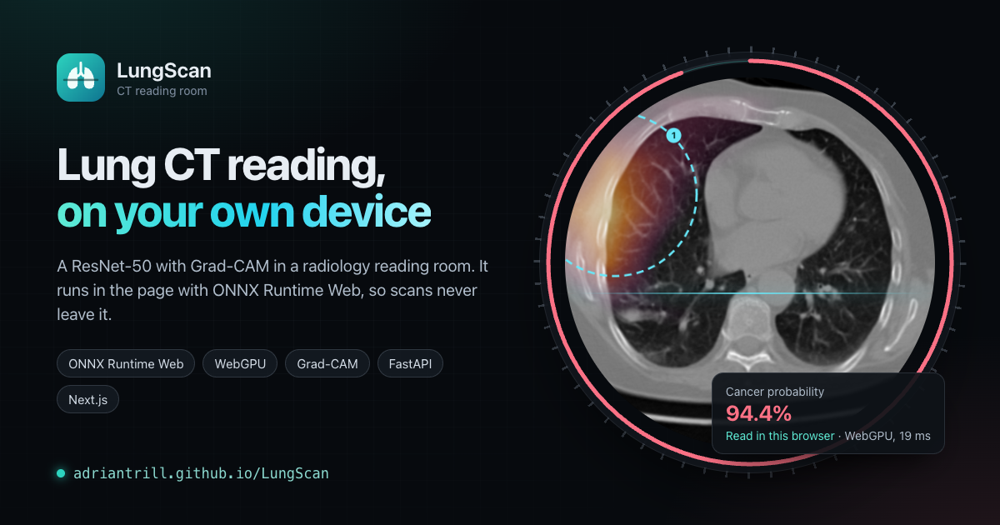
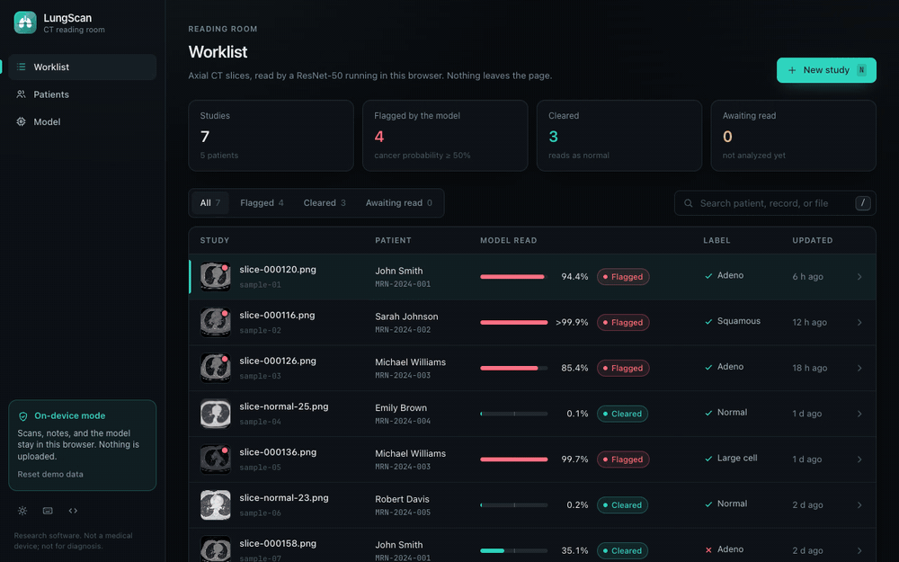
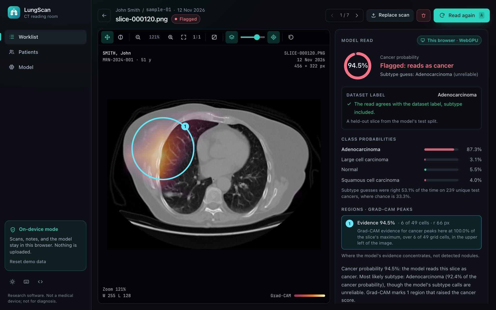
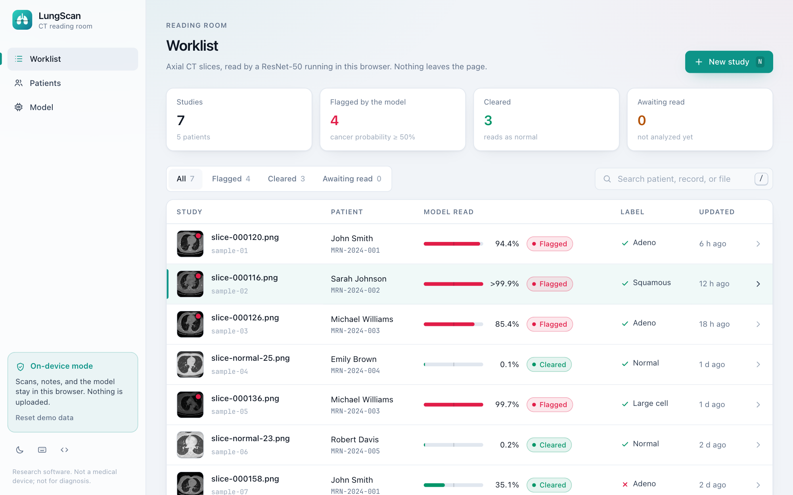
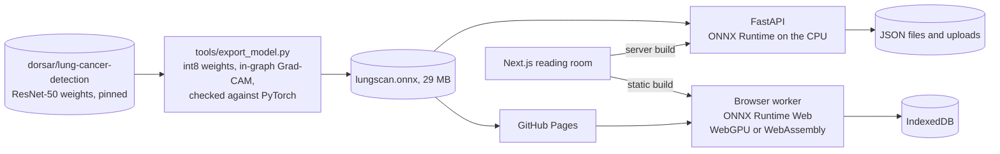
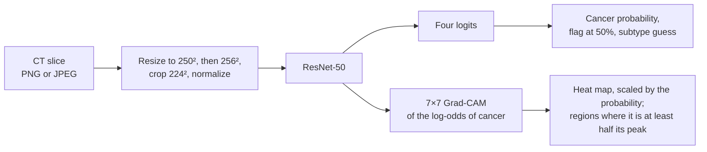
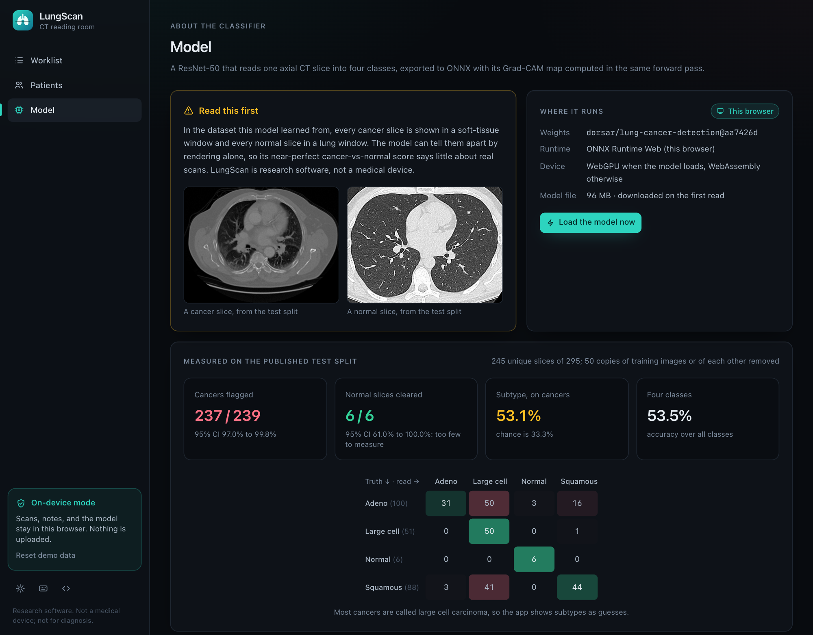

<p align="center">
  <a href="https://adriantrill.github.io/LungScan/"></a>
</p>

<p align="center">
  <a href="https://github.com/AdrianTrill/LungScan/actions/workflows/ci.yml"></a>
  <a href="https://adriantrill.github.io/LungScan/"></a>
  
  
  
  <a href="LICENSE"></a>
</p>

LungScan is a reading room for lung CT: a worklist, a PACS-style viewer, and a model that reads each axial slice for cancer and shows where its evidence lies. The model is a ResNet-50 exported to ONNX with its Grad-CAM map computed in the same forward pass, so one file serves both ways the app runs: behind a FastAPI server with ONNX Runtime, or entirely in the browser with ONNX Runtime Web, where scans never leave the page. The repository also holds the 3D nodule segmentation research of the SENSERA report, which reaches a tumor Dice of 0.73 with VISTA-3D and a false-positive classifier.

> [!IMPORTANT]
> LungScan is research software, not a medical device. Never use it for diagnosis.

<p align="center">
  <a href="https://adriantrill.github.io/LungScan/"></a>
</p>
<p align="center"><em>The <a href="https://adriantrill.github.io/LungScan/">live demo</a> on GitHub Pages: a sample study, read again in the page on WebGPU, then a look at the region that raised the score.</em></p>

## What's inside

| Part | What it does | How it is checked |
| --- | --- | --- |
| **[Reading room](#the-reading-room)** | Worklist, viewer with window and level, Grad-CAM overlay and regions, the model's read, notes, and reports, all on the keyboard | A headless-Chrome run of the real site on every push |
| **[In your browser](#in-your-browser)** | The whole app in the page: IndexedDB for the data, ONNX Runtime Web on WebGPU or WebAssembly for the model, a 29 MB download kept for next time | The same run reads slices in the page and compares them with the server's reads |
| **[One model, two runtimes](#one-model-two-runtimes)** | One ONNX file on the server and in the browser; the browser's preprocessing is a bit-exact port of Pillow 13's resize | Jest tests against fixtures written by the server's own code |
| **[Grad-CAM in one pass](#grad-cam-in-one-forward-pass)** | The classifier head's gradient, computed inside the graph, so the browser needs no backward pass | The export must match autograd's Grad-CAM before it is written |
| **[Int8 weights](#int8-weights-a-third-of-the-download)** | Convolutions stored as int8 blocks with their own scales: 29 MB instead of 96 | On all 367 validation and test slices, every flag and class matches the published float32 weights |
| **[Measured, not quoted](#measured-performance)** | An evaluation on the published test split, after removing the 50 test images that copy training images or each other | CI re-runs it from a fresh export and requires the same numbers |
| **[3D segmentation research](#3d-segmentation-research)** | VISTA-3D with a "Shadow Mining" false-positive classifier, and radiogenomic biomarker prediction | Reported in the SENSERA report |

**Contents:** [Try it](#try-it) · [Reading room](#the-reading-room) · [In your browser](#in-your-browser) · [Two runtimes](#one-model-two-runtimes) · [Grad-CAM](#grad-cam-in-one-forward-pass) · [Int8](#int8-weights-a-third-of-the-download) · [Performance](#measured-performance) · [Research](#3d-segmentation-research) · [Layout](#repository-layout) · [Run locally](#run-it-locally) · [API](#api) · [Tests and CI](#tests-and-ci) · [Credits](#credits)

## Try it

**[Open the live demo](https://adriantrill.github.io/LungScan/).** It starts with seven sample studies from the model's held-out test split, already read. Open one and press <kbd>A</kbd> to read it again in your browser: the model (29 MB) downloads once, its SHA-256 is checked, and from then on a read takes about 20 ms on WebGPU or 200 ms on WebAssembly. Press <kbd>N</kbd> to add a slice of your own, or one of the samples, and <kbd>?</kbd> for every shortcut. Everything you add stays in your browser; **Reset demo data** in the sidebar starts over.

To run it yourself, with the FastAPI backend:

```bash
./scripts/setup.sh   # Python venv, npm install, and the model
./scripts/dev.sh     # backend on :8000, frontend on :3000
```

## The reading room

<p align="center">
  
</p>

The reading view puts the slice beside the model's read, with the previous and next study a key away (<kbd>[</kbd> <kbd>]</kbd>).

- **The viewer** zooms around the cursor and pans; dragging with the window tool (<kbd>W</kbd>), or with the right button, sets window and level. That is an exact linear transfer on each channel, applied as an SVG filter, so display settings never resample the pixels. <kbd>I</kbd> inverts, <kbd>H</kbd> and <kbd>R</kbd> toggle the heat map and the regions, <kbd>F</kbd> fits, and <kbd>0</kbd> resets. The corners carry the patient, the study, the zoom, the window, and a readout of the pixel value and the Grad-CAM value under the cursor.
- **The read** gives the cancer probability, the class probabilities, and the subtype as a guess beside its measured accuracy. Each region lists its evidence and position; hovering highlights it in the viewer and a click zooms to it. For the sample slices, a panel compares the read with the dataset's label, including the misses.
- **Notes** save as you type, and <kbd>E</kbd> exports a plain-text report with the read, the regions, and the notes.

<p align="center">
  
</p>

The worklist shows each study's patient, the model's cancer probability against the 50% threshold, its status, and, for the samples, whether the flag agrees with the dataset label. It filters by status and searches by patient, record, or file (<kbd>/</kbd>); <kbd>J</kbd>, <kbd>K</kbd>, and <kbd>Enter</kbd> move through it. A patients page and a page per patient group the studies, and the model page shows how the classifier was measured. The app comes in a dark reading-room theme and a light one (<kbd>T</kbd>), and fits a phone's screen.

## In your browser

The live demo is the same Next.js app, exported as a static site, with the backend replaced by one that runs in the page:

- Studies, patients, notes, and images live in **IndexedDB**. The first visit seeds the sample studies with the reads the server computed for them.
- The model runs in a **worker** ([`inference-worker.js`](frontend/public/inference-worker.js)) with ONNX Runtime Web 1.31: on **WebGPU** when the browser has an adapter, on **WebAssembly** otherwise, loading only the build it uses (the WebAssembly one is 3.9 MB gzipped). GitHub Pages cannot send the headers WebAssembly threads need, so that path uses one thread.
- The model file, 29 MB, is downloaded once with progress, checked against the SHA-256 in its manifest, and kept in Cache Storage, where a new version replaces the old one.

On an Apple M4, a read takes about 20 ms on WebGPU and under 200 ms on WebAssembly. The server takes about 20 ms on the CPU.

## One model, two runtimes



The app talks to one interface, `LungScanApi`, with two implementations: [the FastAPI client](frontend/src/lib/api/server.ts) and [the in-browser backend](frontend/src/lib/api/browser.ts). Both run the same file, and the browser reproduces every step around it:

- **Preprocessing.** The model's training code resized slices to 250×250, then to 256×256, and cropped the central 224×224. The server does this with Pillow. The browser ports [Pillow 13's bilinear resize](frontend/src/lib/inference/resample.ts): its fixed-point weights, the rounding between passes, and the order of the passes, which Pillow 13 picks by the image's shape. A PNG slice reaches the network as exactly the same tensor on both sides.
- **Interpretation and reports.** [`interpret.ts`](frontend/src/lib/inference/interpret.ts) and [`report.ts`](frontend/src/lib/report.ts) port the server's code, rounding half up throughout.
- **Checks.** Jest holds the ports to fixtures that [`tools/make_fixtures.py`](backend/tools/make_fixtures.py) writes from the server's own code: six resize shapes byte for byte, every sample's read, and the report character for character. In headless Chrome, the browser's reads of the seven samples agree with the server's to within 10⁻⁵ (exactly, for five of them on WebAssembly); the runtimes' kernels add in different orders.

A read goes like this:



The cancer probability is the sum of the three cancer classes. The heat map is scaled by it, so a confidently normal slice shows none. Regions are the 8-connected groups of grid cells with at least half the peak evidence, at most three, mapped back onto the original slice. They show where the model's evidence concentrates, and are not detected nodules.

## Grad-CAM in one forward pass

Grad-CAM needs the gradient of a score with respect to the last feature maps, and ONNX Runtime Web has no autograd. Here the gradient is computed inside the graph. The score is the log-odds of cancer, `s = logsumexp(z_adeno, z_large, z_squamous) − z_normal`, and the head is `z = W₂ · relu(W₁ · p + b₁) + b₂` on the pooled features `p`:

- `∂s/∂z` is the softmax over the three cancer logits, and −1 for normal;
- `∂s/∂p = W₁ᵀ (relu′(h) ⊙ W₂ᵀ ∂s/∂z)`: two matrix products;
- global average pooling gives every location the same gradient, `∂s/∂p / 49`, which are Grad-CAM's channel weights.

[`ExplainedNet`](backend/tools/network.py) adds these steps to the network before export. The exporter refuses to write the file unless ONNX Runtime matches PyTorch's logits with the same weights (largest difference 3.3×10⁻⁶) and the map matches autograd's Grad-CAM (5.1×10⁻⁷), and a unit test checks the identity on random weights. The model card, [docs/MODEL.md](docs/MODEL.md), has the details.

## Int8 weights: a third of the download

Convolution weights are nearly all of the file. [`tools/quantize.py`](backend/tools/quantize.py) folds each BatchNorm into its convolution, then stores the convolutions of layers 2 to 4 as int8, in blocks of 32 weights that each have a float32 scale, as the weights of large language models often are. The stem and layer 1 stay in float32: they hold under 1% of the weights, but rounding them causes most of the error. In the file, each of those weights is `Reshape(Cast(int8) × scale)`. Every input is a constant, so ONNX Runtime folds them back into float32 weights when it loads the file, on the server and in the browser: a read costs what it did, and PyTorch reproduces it exactly.

The file shrinks from 96.1 MB to 29.3 MB. On all 367 validation and test slices, every flag and every class matches the published float32 weights, and no cancer probability moves by more than 1.5 points. The exporter refuses a file whose int8 weights change a sample slice's read, and CI requires the agreement to stay as measured. [docs/MODEL.md](docs/MODEL.md#int8-weights) compares the schemes that were tried.

## Measured performance

The classifier is [dorsar/lung-cancer-detection](https://huggingface.co/dorsar/lung-cancer-detection) (MIT), a ResNet-50 fine-tuned on 2D slices in four classes. [`tools/evaluate.py`](backend/tools/evaluate.py) runs the app's own pipeline on the test split published with it, and writes [model/evaluation.json](model/evaluation.json).

**The test split is mostly duplicates for normal slices.** It has 295 images, not the 315 its dataset card lists, and 48 of its 54 normal slices are copies of training images or of each other: 42 identical, 5 re-encoded or resized, found with a perceptual hash, and 1 repeated. Two cancer slices repeat as well. On the 245 unique slices:

| Measure | Result |
| --- | --- |
| Cancers flagged | 237 of 239 (99.2%; 95% CI 97.0 to 99.8%) |
| Normal slices cleared | 6 of 6 (95% CI 61 to 100%: too few to measure) |
| Subtype, on cancer slices | 53.1%, where chance is 33.3% |
| Four classes | 53.5% |

**What the numbers leave open.** Every image comes from this one public dataset of 2D, 8-bit slices, so these results say nothing yet about scans from other hospitals or scanners, and six unique normal slices are too few to measure specificity. The subtype is right about half the time; LungScan shows it as a guess beside its measured accuracy, and labels each sample's read against the truth, misses included.

<p align="center">
  
</p>

The preprocessing also changed. The previous backend stretched slices to 224×224, normalized every channel with the red channel's statistics, and classified 224-pixel patches with a sliding window. On the validation split, the training pipeline scores 0.667 four-class accuracy against 0.500 for that pipeline, and on the whole test split the old patch scheme flagged 4 of the 54 normal slices.

## 3D segmentation research

[AI model/](AI%20model/README.md) holds the team's research on CT volumes, summarized in the [SENSERA report](AI%20model/paper/sensera_report.pdf). The web app does not run these models. As reported:

**Segmentation.** VISTA-3D, a foundation model pretrained on about 11,000 CT scans, proposes candidates. A "Shadow Mining" 3D ResNet-18, trained on hard false positives mined by five cross-validated VISTA-3D models, rejects false positives:

| Metric | VISTA-3D alone | VISTA-3D + ResNet-18 |
| --- | ---: | ---: |
| Tumor Dice (volumetric) | 0.6260 | **0.7342** |
| Recall | **0.9447** | 0.9213 |
| Precision | 0.2745 | **0.6483** |
| False positives per scan | 2.76 | **0.58** |
| Lesion-wise Dice (true positives) | 0.7858 | **0.8102** |

**Biomarkers.** A late fusion of DenseNet121 features and PyRadiomics features with XGBoost reaches an AUC of 0.87 for EGFR and 0.86 for KRAS mutations on TCGA-LUAD and NSCLC Radiogenomics, and 0.80 for TTF-1 and 0.76 for CK7 on a private cohort of 92 patients.

The evaluation outputs behind these tables are not in the repository. Neither are the checkpoints, configs, or logs of the earlier architecture comparison in the research notes (SwinUNETR, SegResNet, UNETR++, nnU-Net, with Dice from 0.76 to 0.82), so those figures are reported, not reproducible here.

## Repository layout

```text
.
├── .github/workflows/
│   ├── ci.yml                 # backend, model, and frontend checks
│   └── pages.yml              # in-browser build, headless-Chrome check, deploy
├── backend/                   # FastAPI
│   ├── app/
│   │   ├── api/routes/        # cases, patients, upload, analyze, images, report, health
│   │   ├── core/              # settings, schemas, upload checks
│   │   ├── services/
│   │   │   ├── model.py       # preprocessing, download, ONNX Runtime
│   │   │   ├── analysis.py    # from the network's output to a read
│   │   │   ├── storage.py     # JSON persistence and the sample studies
│   │   │   └── report.py
│   │   └── tests/
│   ├── tools/                 # export_model, quantize, evaluate, make_samples, make_fixtures, fetch_model
│   ├── requirements.txt       # the server: no PyTorch
│   ├── requirements-dev.txt
│   └── requirements-model.txt # the tools: PyTorch, ONNX, Hugging Face
├── frontend/                  # Next.js 14
│   ├── public/
│   │   ├── inference-worker.js
│   │   └── social.png
│   ├── scripts/               # copy-assets, ui-check, capture, serve
│   └── src/
│       ├── app/               # worklist, case, patients, patient, model
│       ├── components/        # viewer, read, studies, dialogs, shell, ui
│       ├── lib/
│       │   ├── api/           # LungScanApi: server.ts and browser.ts
│       │   ├── browser/       # IndexedDB and the sample studies
│       │   └── inference/     # resample, preprocess, interpret, engine
│       └── tests/
├── model/
│   ├── evaluation.json        # measured by tools/evaluate.py
│   └── samples/               # seven test slices and their reference reads
├── docs/
│   ├── MODEL.md               # the model card
│   ├── assets/
│   └── planning/
├── scripts/                   # setup.sh, dev.sh, dev_backend.sh, dev_frontend.sh
├── model_demonstration.ipynb
└── AI model/                  # 3D segmentation and biomarker research
```

## Run it locally

Requirements: Python 3.11+ and Node 22.

```bash
./scripts/setup.sh           # once
./scripts/dev.sh             # both servers; or dev_backend.sh and dev_frontend.sh
```

The frontend is at http://localhost:3000, the API at http://127.0.0.1:8000, and its documentation at http://127.0.0.1:8000/docs. A new data directory starts with the sample studies. The server downloads the model on its first read if `setup.sh` could not.

By hand:

```bash
cd backend
python3 -m venv .venv && source .venv/bin/activate
pip install -r requirements-dev.txt
python -m tools.fetch_model                 # or build it: pip install -r requirements-model.txt
                                            #              python -m tools.export_model
uvicorn app.main:app --reload

cd frontend
npm install
npm run dev                                 # against the API
npm run dev:browser                         # the in-browser app, with the model from ../model/
```

Settings live in [`backend/.env.example`](backend/.env.example) and [`frontend/.env.example`](frontend/.env.example). The static site builds with `NEXT_PUBLIC_BASE_PATH=/LungScan npm run build:browser` into `frontend/out/`.

## API

| Method | Path | What it does |
| --- | --- | --- |
| `GET` | `/api/health` | Health check |
| `GET` | `/api/model` | The model, its runtime, and whether its file is present |
| `POST` | `/api/upload` | Upload a PNG or JPEG slice (`scan`, optional `patient_id`), create a case, and read it |
| `POST` | `/api/analyze/{case_id}` | Read a case's slice again |
| `GET` | `/api/cases` | All cases, newest first, with their latest cancer probability |
| `GET` | `/api/cases/{case_id}` | A case with its patient, read, and notes |
| `GET` | `/api/cases/{case_id}/image` | The case's slice |
| `PUT` | `/api/cases/{case_id}/replace-scan` | Replace the slice; the case goes back to pending |
| `PUT` | `/api/cases/{case_id}/notes` | Save the notes |
| `DELETE` | `/api/cases/{case_id}` | Delete a case, its image, read, and notes |
| `POST` | `/api/report/{case_id}` | Save the notes and return the plain-text report |
| `GET`, `POST` | `/api/patients` | List patients, or create one |
| `GET`, `DELETE` | `/api/patients/{patient_id}` | A patient with their cases, or delete one who has none |
| `POST` | `/api/cases/{case_id}/assign/{patient_id}` | Assign a case to a patient |

A read carries the class probabilities, the cancer probability and flag, the subtype, the heat map with the part of the slice it covers, the regions, a summary, the model and runtime, and the time spent in the network.

## Tests and CI

```bash
cd backend && pytest                     # 30 tests; the model's tests run once it is exported
cd frontend && npm test                  # 38 tests
cd frontend && node scripts/ui-check.mjs out    # the static site, in headless Chrome
```

| Workflow | Job | What it checks |
| --- | --- | --- |
| CI | Backend / Python 3.11, 3.12, 3.13 | ruff, black, and the test suite against an isolated store and a stand-in model |
| CI | Model | Exports the pinned weights, which must match PyTorch and autograd, and whose int8 form must read every sample slice as the float32 weights do; runs the tests with the real model; re-reads the samples; re-runs the evaluation, which must give the same numbers, int8 agreement included; and requires the frontend's fixtures to be current |
| CI | Frontend | Prettier, ESLint, the type check, the Jest suite, and the build against the API |
| Pages | In-browser build | Exports the model and builds the static site, then drives it in headless Chrome: the worklist, filters, search, and keys; two reads in the page against the server's; an upload read straight away; notes across a reload; the viewer's keys, the theme, and the shortcuts; a phone's screen; no console errors or failed requests. Main is then deployed |

[`scripts/capture.mjs`](frontend/scripts/capture.mjs) regenerates this README's images and the link preview from the static site.

## Next steps

- DICOM input, with windows in Hounsfield units instead of 8-bit renders.
- A classifier trained on volumes with patient-level splits and tested on scans from other sources, instead of a 2D model on one public dataset; the research's segmentation models are the natural candidates.

## Credits

- The classifier is [dorsar/lung-cancer-detection](https://huggingface.co/dorsar/lung-cancer-detection) (LungAI, MIT), and the sample slices come from its test split.
- The 3D segmentation and biomarker research, and the SENSERA report, are by Roberto Hordoan, Razvan Bocra, Marius Boroica, and Mihai Deaconu.
- Built with [ONNX Runtime](https://onnxruntime.ai), [PyTorch](https://pytorch.org), [MONAI](https://monai.io), [FastAPI](https://fastapi.tiangolo.com), and [Next.js](https://nextjs.org).

Released under the [MIT License](LICENSE).
